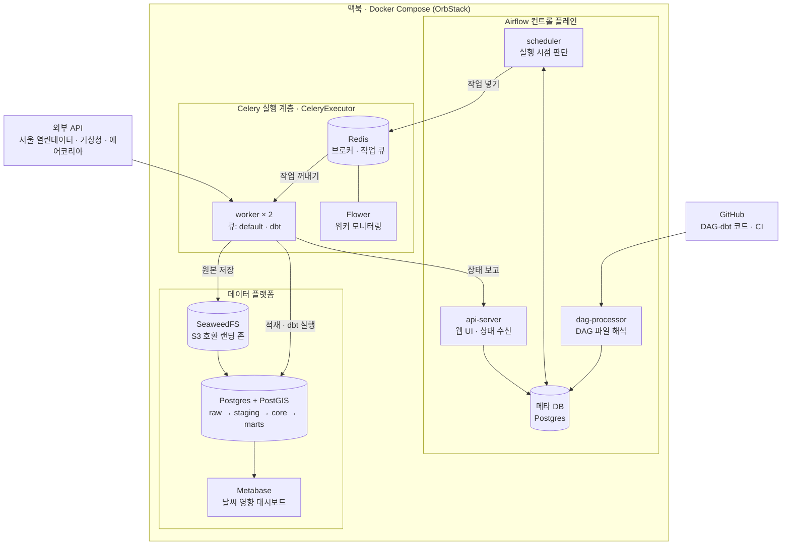
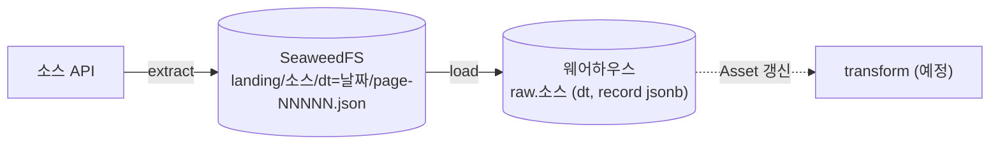

# 아키텍처

> 비가 오면 서울 사람들은 어떻게 움직이고, 어디에 머무나?

날씨 데이터와 서울의 이동·인구 데이터를 매일 모아 **날씨가 일상에 주는 영향**을 보여 주는 데이터 마트.
현업 데이터 플랫폼을 맥북 한 대 위에 축소해 재현하는 것이 목표다.

## 1. 전체 구조



태스크 하나가 도는 흐름:

1. **판단** — dag-processor가 DAG 파일을 해석해 메타 DB에 올리고, scheduler가 실행 시점이 된 태스크를 Redis 큐에 넣는다.
2. **실행** — 손이 빈 Celery worker가 큐에서 꺼내 외부 API를 호출하고, 응답 원본을 SeaweedFS에, 적재 결과를 웨어하우스 `raw` 스키마에 쓴다.
3. **보고** — worker는 상태를 api-server에 보고하고 api-server가 메타 DB에 기록한다 (Airflow 3부터 worker는 메타 DB에 직접 붙지 않는다).
4. **변환** — raw가 갱신되면 dbt가 웨어하우스 안에서 staging → core → marts를 만들고, Metabase가 marts를 읽는다.

## 2. 구성 요소

| 컨테이너 | 역할 | 현업에서의 대응 |
|---|---|---|
| airflow-api-server | 웹 UI, worker 상태 수신(Task Execution API) | MWAA · Astronomer |
| airflow-scheduler | 언제 무엇을 실행할지 판단, 큐에 투입 | 〃 |
| airflow-dag-processor | `dags/` 해석 | 〃 |
| airflow-triggerer | deferrable 태스크(센서 대기 등)를 비동기로 처리 | 〃 |
| airflow-worker | Celery worker. 실제 코드 실행 (`default`·`dbt` 큐) | 〃 |
| airflow-init | DB 마이그레이션·관리자 계정 생성 (1회 실행 후 종료) | — |
| postgres-meta | Airflow 메타 DB + Metabase 앱 DB | RDS |
| redis | Celery 브로커 | ElastiCache |
| flower | Celery 모니터링 | — |
| seaweedfs | S3 호환 오브젝트 스토리지 (랜딩 존, 단일 노드) | S3 · GCS |
| seaweedfs-init | `landing` 버킷 생성 (1회 실행 후 종료) | — |
| postgres-warehouse | 웨어하우스 (PostGIS 확장, `raw`·`staging`·`core`·`marts` 스키마, BI 읽기 전용 계정 `bi_reader`) | Redshift · Snowflake · BigQuery |
| metabase | BI | Tableau · Looker · Superset |

상시 실행 컨테이너 11개 + 초기화용 2개. 개발 머신은 M3 Pro 18GB.

- 웨어하우스 이미지는 `postgis/postgis`(amd64 전용) 대신 공식 `postgres:17`에 PGDG PostGIS 패키지를 얹어 Apple Silicon에서 네이티브로 돈다.
- 모든 포트는 `127.0.0.1`에만 열어 같은 네트워크의 다른 기기에서 접근할 수 없다.

## 3. 스택 선택 이유

- **Airflow 3 + CeleryExecutor** — scheduler(판단)와 worker(실행)를 Redis 큐로 분리한 현업 표준 구조를 연습한다. 맥북 한 대에는 LocalExecutor로도 충분하지만, worker 증설·장애 시 작업 반환·큐 분리 같은 운영 감각을 얻기 위해 Celery를 쓴다.
- **Redis** — 서로를 모르는 scheduler와 worker 사이의 작업 보관함(메시지 브로커). 한 작업은 한 worker만 가져가고, 완료 확인(ack) 전에 worker가 죽으면 작업이 큐로 돌아온다. 영구 기록은 메타 DB가 맡는다.
- **SeaweedFS (MinIO 대신)** — MinIO 커뮤니티 에디션은 2025년 10월 무렵 공식 Docker 이미지 배포를 멈췄고, 2025년 12월 유지보수 모드를 거쳐 2026년 저장소가 아카이브됐다. 보안 패치가 없으므로 Apache 2.0이고 오래 쓰인 SeaweedFS로 대체한다. S3 API 호환이라 코드는 `endpoint_url`만 다르다.
- **Postgres + PostGIS** — 관측소·대여소·역 좌표를 행정동 경계와 공간 조인해야 한다. SQL 문법이 Redshift와 가깝다.
- **dbt** — 변환은 웨어하우스 안에서 SQL로 (ELT). 테스트·문서·계보를 함께 관리한다.
- **Metabase** — 설치가 가장 가벼운 BI.

## 4. 데이터 소스

| 소스 | 제공처 | 주기 | 수집 DAG | 비고 |
|---|---|---|---|---|
| 종관기상관측 ASOS | 기상청 | 매시 | daily_batch | 정답 기상 |
| 방재기상관측 AWS | 기상청 API허브 | 매시 | daily_batch | 촘촘한 관측, 고정폭 텍스트 |
| 대기오염 측정 | 에어코리아 | 매시 | daily_batch | 미세먼지·오존 |
| 따릉이 이용 건수 | 서울 열린데이터광장 | 일 | daily_batch | |
| 지하철 역별 승하차 | 서울 열린데이터광장 | 일 | daily_batch | 공개 지연 있음 |
| 서울 생활인구 (행정동) | 서울 열린데이터광장 | 일 | daily_batch | 공개 지연 있음 |
| 따릉이 대여소 거치 현황 | 서울 열린데이터광장 | 실시간 | realtime_poll | 10분 스냅샷 |
| 실시간 도시데이터 (주요 장소) | 서울 열린데이터광장 | 실시간 | realtime_poll | 10분 스냅샷 |
| 지하철 시간대별 승하차 | 서울 열린데이터광장 | 월 | reference_sync | |
| 행정동 경계 | 행정안전부 등 | 수시 | reference_sync | GeoJSON |
| 특일정보 (공휴일) | 한국천문연구원 | 연 | reference_sync | |
| 대여소·역 위치 마스터 | 서울 열린데이터광장 | 수시 | reference_sync | SCD Type 2 |

정확한 API 이름, 공개 지연, 이용 조건은 수집기를 붙일 때 소스별로 확인해 README 표에 채운다.

## 5. DAG 설계

주기마다 적재 방식이 달라서 DAG을 셋으로 나눈다.

| DAG | 스케줄 | 적재 방식 |
|---|---|---|
| `realtime_poll` | 10분마다 | 현재 상태 스냅샷을 append. 지나간 시점은 다시 받을 수 없다 |
| `daily_batch` | 매일 | 소스별 공개 지연만큼 이전 날짜를 받아 `dt` 파티션 단위로 delete + insert (멱등) |
| `reference_sync` | 매월 | 기준 데이터 변경분을 SCD Type 2로 이력 관리 |
| `transform` | raw Asset 갱신 시 | dbt source freshness → build(staging → core → marts) → 알림 |

- 소스가 늘어나도 DAG을 손으로 쓰지 않는다. `sources.yml`(이름·주기·클라이언트·파티션 키·지연)에서 DAG을 생성하는 **DAG 팩토리**로 만든다.

### 일 배치 수집 (구현됨)

`airflow/dags/ingest_factory.py`가 `sources.yml`의 소스마다 `ingest__<소스>` DAG을 만든다. 소스별로 DAG을 나눠 backfill·재실행·일시 중지를 소스 단위로 할 수 있다. 위 표의 `daily_batch`는 이 DAG들의 묶음이다.



- **수집 대상 날짜** = 실행 시각(KST)의 날짜 − `lag_days`. 공개 전이면 `DataNotReady`로 실패시키고 1시간 뒤 재시도한다(최대 3회). 첫 페이지를 받기 전에는 랜딩 존을 지우지 않아 이전 원본이 남는다.
- **extract**: 페이지별 원본을 그대로 저장한다. 같은 dt를 다시 받으면 프리픽스를 비우고 새로 쓴다.
- **load**: 테이블별 advisory lock → `DELETE WHERE dt` → `INSERT`를 한 트랜잭션으로 한다. 레코드는 JSONB 그대로 두고 타입·컬럼 정리는 dbt staging에서 한다.
- 로직은 `src/swl`(Airflow 비의존)에 있고 pytest로 검증한다. DAG은 Airflow Connection(`landing`, `warehouse`)만 넘긴다.

| 소스 | API 서비스 | 공개 지연 | 하루 행 수 |
|---|---|---|---|
| `seoul_subway_daily` | `CardSubwayStatsNew` | 3일 | 약 600 |
| `seoul_bike_rent_daily` | `tbCycleRentUseDayInfo` | 1일 | 4~6만 |
| `kma_asos_hourly` | ASOS 시간자료 `getWthrDataList` (공공데이터포털) | 1일 | 관측소당 24 |

ASOS는 요청 한 번에 관측소 하나만 받으므로 `params.stations`의 관측소마다 요청한다. 현재는 서울(108)만 받는다.

공개 지연은 2026-11-27에 API를 직접 호출해 확인했다.

**backfill 주의**: `airflow backfill create`의 `--from-date`·`--to-date`는 DAG 시간대(KST)의 **자정**으로 해석된다. 스케줄이 매일 07:00이라 `--to-date` 당일 07:00 실행은 범위에 들어가지 않는다. KST D일 실행까지 포함하려면 `--to-date`를 D+1로 준다. 이미 있는 실행은 건너뛰고(기본 `reprocess_behavior`), 범위를 넉넉히 잡아도 멱등이라 안전하다. 실제로 만들어질 실행은 `--dry-run`으로 먼저 확인한다.
- worker 큐는 `default`(API 호출·적재)와 `dbt`(변환)로 나눠 무거운 변환이 수집을 막지 않게 한다.

## 6. 웨어하우스 레이어

| 스키마 | 내용 | 구체화 |
|---|---|---|
| `raw` | API 응답을 거의 그대로 | table (적재기) |
| `staging` | 타입·단위·시간대(KST) 정리, 컬럼명 통일 | view |
| `core` | 공통 차원 + 주제별 팩트 | table / incremental |
| `marts` | 분석·대시보드용 최종 마트 | table |

### 버스 매트릭스

모든 주제가 **날짜·시간·행정동** 공통 차원을 공유한다.

| 팩트 | 그레인 | dim_date | dim_hour | dim_dong | 주제 차원 |
|---|---|:-:|:-:|:-:|---|
| `fct_weather_hourly` | 행정동 × 시간 | ✓ | ✓ | ✓ | |
| `fct_air_quality_hourly` | 행정동 × 시간 | ✓ | ✓ | ✓ | |
| `fct_bike_rides_daily` | 대여소 × 일 | ✓ | | ✓ | dim_bike_station |
| `fct_bike_availability` | 대여소 × 10분 | ✓ | ✓ | ✓ | dim_bike_station |
| `fct_subway_ridership` | 역 × 일 | ✓ | ✓ | ✓ | dim_subway_station |
| `fct_living_population` | 행정동 × 시간 | ✓ | ✓ | ✓ | |
| `fct_place_congestion` | 장소 × 10분 | ✓ | ✓ | ✓ | dim_place |
| **`mart_weather_impact`** | 행정동 × 일 × 날씨 유형 | ✓ | | ✓ | dim_weather_type |

### 핵심 설계 결정

- **`dim_dong`이 연결고리** — 관측소·측정소·대여소·역 좌표를 PostGIS로 행정동에 배정한다. 날씨는 행정동마다 가장 가까운 AWS 관측소 값을 쓴다.
- **"평소 대비"로 비교** — `mart_weather_impact`는 같은 요일·월의 맑은 날 평균을 기준선으로 증감률을 낸다. 날씨 유형: 맑음 · 비 · 폭염 · 한파 · 미세먼지 나쁨.
- **그레인을 섞지 않는다** — 같은 대상이라도 일별 집계와 10분 스냅샷은 별도 팩트로 둔다.

## 7. 설계 원칙

- **원본 보존** — API 응답은 SeaweedFS `landing/소스/dt=날짜/`에 그대로 남긴다. 파싱을 고쳐도 API를 다시 부르지 않고 재처리한다.
- **멱등성** — 모든 일 단위 적재는 날짜 파티션을 지우고 다시 넣는다. 몇 번 재실행·backfill해도 결과가 같다.
- **DAG은 얇게** — 로직은 `src/` 파이썬 패키지에 두고 DAG은 호출만 한다. Airflow 없이 pytest로 테스트한다.
- **비밀값은 코드 밖에** — `.env`와 Airflow Connections로 관리하고 커밋하지 않는다.
- **품질 게이트** — dbt 테스트(키 중복, 값 범위, 관계)와 source freshness가 실패하면 marts 갱신을 멈추고 알린다.

## 8. 환경과 CI

| 단계 | 위치 | 하는 일 |
|---|---|---|
| 개발 | 내 브랜치 | `dbt build --target dev` → 개인 스키마에만 쓴다 |
| PR | GitHub Actions | ruff · sqlfluff · pytest · Postgres 서비스 컨테이너에서 `dbt build --target ci`. 통과해야 머지 |
| 운영 | main 머지 후 | 맥북 Airflow가 main을 마운트해 `prod` 타깃으로 실행 |

## 9. 디렉터리 구조 (계획)

```
├── docker-compose.yml        # airflow · postgres(meta, warehouse) · redis · flower · seaweedfs · metabase
├── .env.example
├── Makefile                  # up / down / dbt-dev / test / lint
├── airflow/
│   ├── Dockerfile            # 공식 이미지 + dbt-postgres + astronomer-cosmos
│   └── dags/                 # DAG 팩토리, transform
├── src/swl/                  # 순수 파이썬 패키지
│   ├── clients/              # 소스별 API 클라이언트 (httpx)
│   ├── storage.py            # SeaweedFS(S3) 읽기·쓰기
│   ├── loaders.py            # 랜딩 존 → raw 적재
│   └── geo.py                # 좌표 ↔ 행정동, 격자 변환
├── sources.yml               # 소스 정의 (DAG 팩토리 입력)
├── dbt/
│   ├── seeds/                # weather_types.csv 등
│   └── models/{staging,core,marts}/
├── tests/
└── .github/workflows/ci.yml
```
